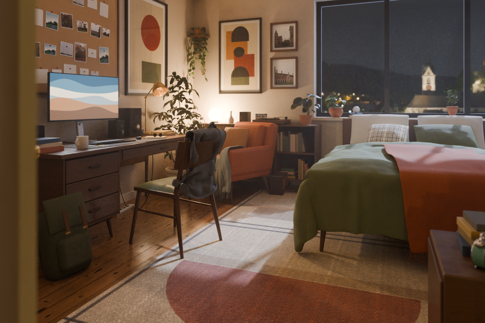

# dorm-room-3d

ミッドセンチュリー風のアメリカの大学寮の部屋を、Blender で作り、Godot で一人称で歩き回れるようにしたプロジェクト。自室(313 号室)、廊下、隣の 315 号室、共用ラウンジ、シャワールームがあり、集中モード(ポモドーロタイマー)と日々の「今日のこと」を記録できる。



## 必要なもの

- Godot 4.7(遊ぶだけならこれだけ)
- Blender 5.2(部屋を作り直すときだけ)

## セットアップ

重いファイルはリポジトリに入れず、[Releases](../../releases) の zip に入れてある。

1. このリポジトリを取得する
2. Releases から `dorm-room-game-assets.zip` をダウンロードし、リポジトリの一番上で展開する
   (`godot_walk/assets/room.glb` と `godot_walk/assets/sky/` ができる)
3. 起動する(初回のみ、取り込みに 1 分ほどかかる)

```bash
godot --path godot_walk
```

Blender で部屋を作り直す場合は、Releases の `dorm-room-blender-source.zip` も同じ場所で展開する
(`dorm_room_real.blend` と `assets_polyhaven/` ができる)。

## 操作

| キー | 動作 |
| --- | --- |
| W A S D / マウス | 移動 / 視点 |
| Shift / Space | 速く歩く / ジャンプ |
| E | 見ている物を使う(ドア、ランプ、モニター、レコード、カーテン、ケトル、マグ、金魚、じょうろ、植物、天井の照明、窓の雨、テレビ、電子レンジ、シャワー、ノック、座る・横になる) |
| R | 次の曲(ターンテーブルを見ているとき) |
| F | 集中モードの開始・終了 |
| Space / ↑↓ / M | 集中モード中: 一時停止 / 集中の長さ / 小窓 |
| T | 昼と夜の切り替え |
| Tab | 今日のこと |
| Z | 眠る(ベッドで横になっているとき) |
| Q | 持っているじょうろを置く |
| P | 写真を保存(ピクチャ/DormRoom) |
| Esc | カーソルを解除 |

好きな曲は `godot_walk/music/` に mp3 / ogg / wav を入れると、ターンテーブルでかかる。

## フォルダ

| 場所 | 中身 |
| --- | --- |
| `godot_walk/` | Godot のプロジェクト(`scripts/` にゲームの処理、`music/`、`assets/sounds/`、`assets/tv/`) |
| `scripts/` | Blender で部屋を作る・書き出すスクリプトと、Godot 用スクリプトの元(`godot_src/`) |
| `textures/` | 自作の柄の画像(ラグ、ポスター、写真のプリント、廊下の貼り紙) |
| `renders/` | Blender でレンダリングした静止画 |
| `docs/設計マップ.html` | 機能の全体像、使う流れ、保存する情報、進み具合 |

## 作り直しの手順

`dorm_room_real.blend` を開いた状態で、次の順にスクリプトを実行すると、部屋の各段階が作り直される。

1. `scripts/r1_pbr.py` 実写スキャンの素材
2. `scripts/r2_models.py` 植物と小物
3. `scripts/r3_details.py` 配線・汚れ・カメラ
4. `scripts/r4_atmosphere.py` 写真・額のガラス・窓の外・霞
5. `scripts/r5_life_objects.py` 暮らしの物(ケトル、金魚鉢、じょうろなど)
6. `scripts/r6_hallway.py` → `scripts/r7_spaces.py` → `scripts/r8_furniture.py` 廊下・315 号室・ラウンジ・シャワールーム・家具

Godot 用の書き出し(`godot_walk/` を作り直す):

```bash
blender -b dorm_room_real.blend --python scripts/render_gpu.py --python scripts/06_export_godot.py
```

## 保存されるデータ

集中の記録と「今日のこと」は Godot の利用者フォルダに保存される(リポジトリには入らない)。
macOS: `~/Library/Application Support/Godot/app_userdata/Dorm Room Walk/`

## 素材とライセンス

- 3D モデル、テクスチャ、HDRI、写真のもとになったパノラマは [Poly Haven](https://polyhaven.com/) の素材(CC0)。
  使用した主な素材: american_walnut_veneer、smoked_walnut_veneer、plank_flooring_02、plastered_wall_04、rough_linen、cotton_jersey、knitted_fleece、velour_velvet、wool_boucle、poly_wool_herringbone、quatrefoil_jacquard_fabric、fabric_leather_02、brown_leather、denim_fabric_04、dirty_carpet、ribbed_corduroy、pachira_aquatica_01、potted_plant_01/02/04、calathea_orbifolia_01、book_encyclopedia_set_01、ceramic_vase_01、alarm_clock_01、stationery_supplies、office_notepads、postcard_set_01、wicker_basket_02、round_spectacles、SchoolChair_01、wooden_display_shelves_01、side_table_01、modern_wooden_cabinet、throw_pillows_01、laufenurg_church(HDRI)、cambridge ほかのパノラマ
- 曲(`01_midnight_dorm_lofi.mp3`)、チャイム・雨・ノック・足音の音、ポスター・貼り紙・ホワイトボードの画像は、このプロジェクトのスクリプトで生成したもの
